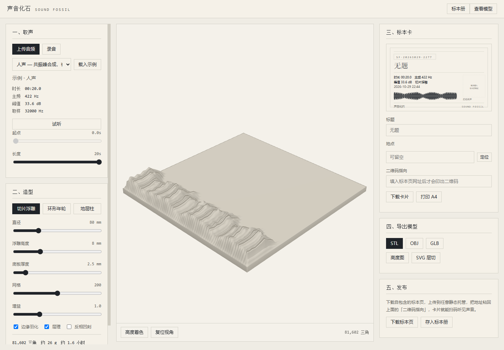
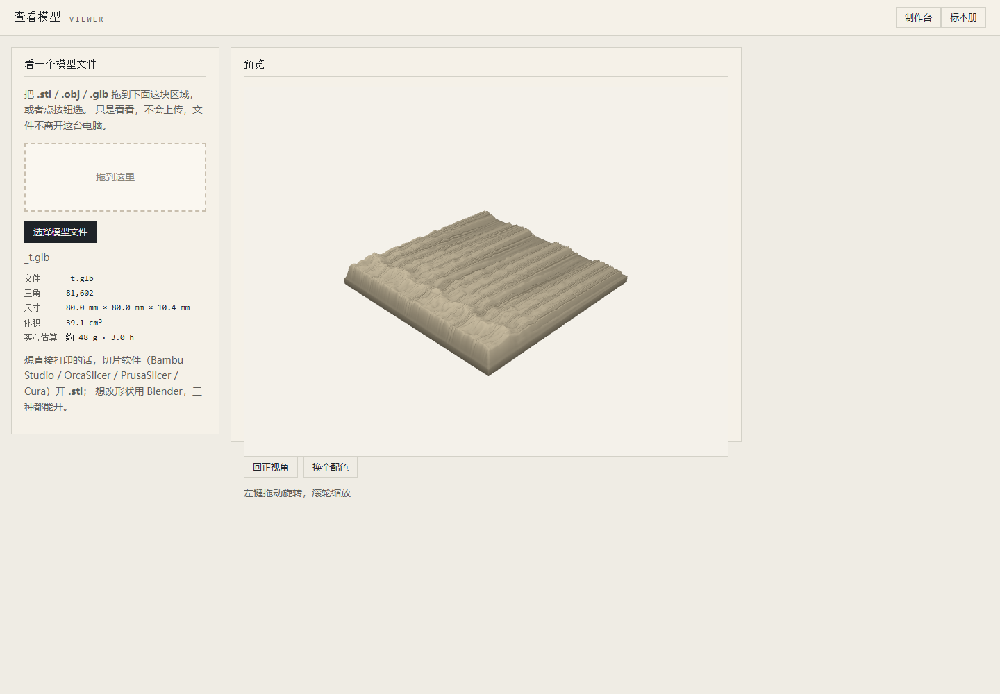

# 声音化石 · Sound Fossil

> 把一段声音，变成一块能拿在手上的东西。

[English](README_EN.md) · 简体中文

录一段声音 → 生成声纹浮雕 → 导出 STL → 3D 打印 → 配一张带二维码的标本卡 → 扫码听见原声。

纯前端，零构建，零依赖；命令行通道只吃 Node 标准库，不装任何包。



## 跑起来

```bash
python serve.py 8080
# 打开 http://127.0.0.1:8080/
```

**必须走 http，不能直接双击 `index.html`。** `file://` 下浏览器不让加载 ES 模块 ——
页面看着在，其实按钮全是死的。真这么打开了，页面会自己弹提示告诉你要起服务。

打开就自动载入一段示例人声，不用先准备素材。

### 取声的三种方式

| 方式 | 怎么操作 | 注意 |
|---|---|---|
| 上传音频 | 点「上传音频」→ 选文件 | 浏览器原生解码，wav / mp3 / flac / ogg / m4a 都行 |
| 录音 | 点「录音」→ 麦克风权限给「允许」→ 说完点「完成」 | 要 http（含 `127.0.0.1`）浏览器才给麦克风；最长 60 秒自动收 |
| 载入示例 | 下拉选一段 → 点「载入示例」 | 内置四段合成音 |

## 三种造型

| 造型 | 映射 | 适合 |
|---|---|---|
| 切片浮雕 | 横轴时间 × 纵轴 mel 频率，高度是能量 | 人声、音乐 |
| 环形年轮 | 半径是时间由内到外，环脊高度是音量，带 ±3% 角度抖动 | 环境声、长录音 |
| 地层柱 | 旋转体，高度轴是时间，半径是音量，可加层理 | 竖着摆，最省耗材 |

三者共用同一条管线，区别只在「声音 → 高度」这一步的映射函数。

## 看模型、打印模型

`web/viewer.html` 是自带的查看器：把 `.stl` / `.obj` / `.glb` **拖进去**就能转着看，
还标出三角数、尺寸、体积和实心估算。文件不上传，不离开本机。



| 格式 | 用什么打开 |
|---|---|
| `.stl` | 切片软件直接开：Bambu Studio / OrcaSlicer / PrusaSlicer / Cura |
| `.obj` | Blender、MeshLab；切片软件也能开 |
| `.glb` | 双击一般被系统「3D 查看器」接走；或 Blender，或本项目 viewer.html |

只想瞄一眼用 viewer.html，要打印就把 `.stl` 丢给切片软件。

## 命令行

给 Agent 和命令行用户走的通道，完整说明见 [`SKILL.md`](SKILL.md)。

```bash
cd scripts
node fossil.js info  input.wav                                  # 这段声音里有什么
node fossil.js make  input.wav --shape slice --out out            # 出 stl / obj / glb
node fossil.js card  input.wav --title "外婆说的那句话" --out card  # 出标本卡 SVG
node fossil.js page  input.wav --title "窗外的风" --out page       # 出自包含标本页
```

命令行只直接支持 WAV。其他格式先转一手：

```bash
ffmpeg -i in.mp3 -ac 1 -ar 32000 out.wav
```

## 扫码回听怎么闭环

1. 生成标本页（音频内嵌在里面，是个自包含的 HTML）
2. 把它当静态站点部署到任何地方，拿到 URL
3. 把 URL 填进卡片的「二维码指向」，重新生成卡片
4. 打印卡片、打印模型 —— 扫卡片上的码就听见声音

**顺序不能反，二维码必须先有 URL。** 没填地址时卡片上画的是虚线空位，不会拿编号充数。

## 目录

整个目录本身就是一个 Skill 包，可以直接装。

```
SKILL.md              Agent 入口
web/                  制作台 + 标本册 + 查看器，自包含，整目录可直接部署
  index.html  museum.html  viewer.html
  lib/                共享内核（浏览器与 Node 同一份）
  src/                浏览器专属：main / preview / audio-io / shelf / viewer-main
  vendor/             three.module.js、OrbitControls.js、qrcode.js
scripts/              Node 通道：fossil.js、png.js
tools/                开发用：make-wav / smoke / gallery
serve.py              静态服务，文档根是 web/
install-skill.py      装到 ~/.workbuddy/skills/sound-fossil/
```

`web/lib/` 下的纯计算模块（dsp / features / shapes / mesh / writers / glb / wav / card-svg /
publish / readers）同时被浏览器和 Node 命令行 import，改一处两边都变。共享内核之所以放在
`web/` 里而不是提到根目录，是因为静态服务以 `web/` 为文档根 —— 提上去就会 404。

## 装成 Skill

```bash
python install-skill.py              # 装到 ~/.workbuddy/skills/sound-fossil/
python install-skill.py --link       # 软链，改源码即时生效，适合自己开发时
```

只装 `SKILL.md` + `scripts/` + `web/` + `serve.py` + `package.json`，`tools/` 和测试音频不进包。

## 开发

```bash
node tools/make-wav.js    # 造四段 20 秒测试音频到 tools/testdata/
node tools/smoke.js       # 4 段声音 × 3 种造型全量校验（含绕向与体积）
node tools/gallery.js     # 生成模型预览图集
```

冒烟测试会用有向体积验证三角形绕向：12 个模型的有向体积与解析体积偏差 < 5%，
说明三种拓扑的法线都朝外、没有翻面。

## 已知的分寸

- 克数是**按 100% 实心**算的，切片开填充后会明显更省
- 默认 80×80mm：切片约 48g / 3h，年轮约 61g / 3.8h，地层柱约 18g / 1.1h
- 标本册只有 5MB 的 localStorage，音频只留最近三条，超了自动清理
- 卡片是矢量 SVG，所以 Node 端也能出图；字长按全角 1em / 半角 0.5em 估算后截断 ——
  SVG 里量不出真实文字宽度，这是唯一的近似处
- 示例声音是合成的，真人声音的纹理完全不同
