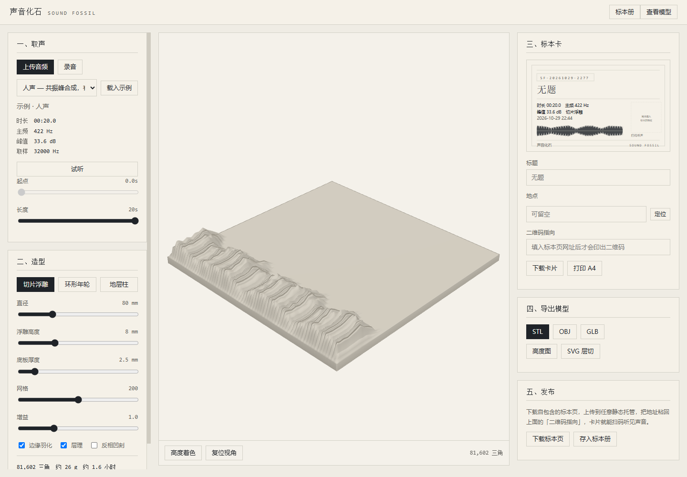
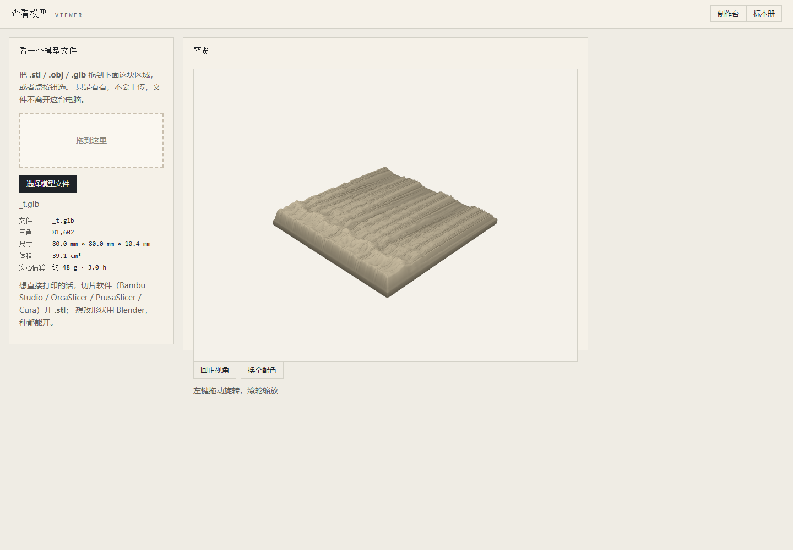

# Sound Fossil

> Turn a sound into something you can hold in your hand.

English · [简体中文](README.md)

Record a sound → generate a waveform relief → export STL → 3D print → pair it with a
specimen card carrying a QR code → scan it and hear the original sound.

Pure frontend. No build step, no dependencies. The CLI path uses nothing but the Node
standard library — install nothing.



## Run it

```bash
python serve.py 8080
# open http://127.0.0.1:8080/
```

**You must serve it over http — do not just double-click `index.html`.** Browsers refuse to
load ES modules from `file://`. The page still renders, but every button is dead. If you do
open it that way, the page now tells you so instead of failing silently.

It loads a sample voice clip on startup, so there is something on screen without any
materials of your own.

### Three ways to feed it a sound

| Method | How | Notes |
|---|---|---|
| Upload | Click **Upload** → pick a file | Decoded natively: wav / mp3 / flac / ogg / m4a |
| Record | Click **Record** → allow mic → click **Done** | Requires http (incl. `127.0.0.1`); caps at 60s |
| Load sample | Pick from the dropdown → click **Load** | Four built-in synthesized sounds |

## Three shapes

| Shape | Mapping | Best for |
|---|---|---|
| Slice relief | X = time, Y = mel frequency, height = energy | Voice, music |
| Ring / growth rings | Radius = time outward, ridge height = loudness, ±3% angular jitter | Ambient, long takes |
| Strata column | Lathe; height axis = time, radius = loudness, optional striations | Stands upright, least filament |

All three share one pipeline. They differ only in the "sound → height" mapping function.

## Viewing and printing

`web/viewer.html` is a built-in viewer: **drag** a `.stl` / `.obj` / `.glb` onto it to orbit
around it. It also reports triangle count, dimensions, volume and a solid-print estimate.
Files never leave your machine.



| Format | Open with |
|---|---|
| `.stl` | Any slicer: Bambu Studio / OrcaSlicer / PrusaSlicer / Cura |
| `.obj` | Blender, MeshLab; slicers handle it too |
| `.glb` | Usually opens in the OS 3D Viewer; or Blender, or this project's viewer.html |

Use viewer.html for a quick look; hand the `.stl` to a slicer when you want to print.

## Command line

The channel for agents and terminal users. Full reference in [`SKILL.md`](SKILL.md)
(Chinese).

```bash
cd scripts
node fossil.js info  input.wav                                   # what's in this sound
node fossil.js make  input.wav --shape slice --out out             # stl / obj / glb
node fossil.js card  input.wav --title "Something she said" --out card
node fossil.js page  input.wav --title "Wind outside" --out page   # self-contained page
```

The CLI reads WAV only. Convert everything else first:

```bash
ffmpeg -i in.mp3 -ac 1 -ar 32000 out.wav
```

## Closing the scan-to-listen loop

1. Generate the specimen page (the audio is embedded — it's a self-contained HTML file)
2. Deploy it as a static site anywhere, get the URL
3. Put that URL into the card's "QR target" field and regenerate the card
4. Print the card, print the model — scan the card and the sound plays

**The order matters: the QR code needs a URL before it can exist.** With no URL the card
draws a dashed placeholder rather than encoding a meaningless ID.

## Layout

The whole directory is a Skill package and can be installed as one.

```
SKILL.md              Agent entry point (Chinese)
web/                  Workbench + shelf + viewer; self-contained, deployable as-is
  index.html  museum.html  viewer.html
  lib/                Shared core (one copy, used by both browser and Node)
  src/                Browser-only: main / preview / audio-io / shelf / viewer-main
  vendor/             three.module.js, OrbitControls.js, qrcode.js
scripts/              Node channel: fossil.js, png.js
tools/                Development: make-wav / smoke / gallery
serve.py              Static server, document root is web/
install-skill.py      Installs to ~/.workbuddy/skills/sound-fossil/
```

The pure-compute modules under `web/lib/` (dsp / features / shapes / mesh / writers / glb /
wav / card-svg / publish / readers) are imported by both the browser and the CLI — one
source of truth. The shared core lives *inside* `web/` rather than at the repo root because
the static server uses `web/` as its document root; move it up and every import 404s.

## Install as a Skill

```bash
python install-skill.py              # installs to ~/.workbuddy/skills/sound-fossil/
python install-skill.py --link       # symlink; source edits take effect immediately
```

Only `SKILL.md` + `scripts/` + `web/` + `serve.py` + `package.json` are installed. `tools/`
and the test audio stay out.

## Development

```bash
node tools/make-wav.js    # synthesize four 20s test clips into tools/testdata/
node tools/smoke.js       # 4 sounds × 3 shapes, full validation (winding + volume)
node tools/gallery.js     # build a preview gallery of the models
```

The smoke test verifies triangle winding via signed volume: across all 12 models the signed
volume agrees with the analytic volume to within 5%, which means normals point outward on
all three topologies and no faces are flipped.

## Known limits

- Weight is estimated at **100% infill**; a real sliced print uses far less
- Default 80×80mm: slice ≈ 48 g / 3 h, ring ≈ 61 g / 3.8 h, column ≈ 18 g / 1.1 h
- The shelf has 5 MB of localStorage; only the three most recent clips are kept
- Cards are vector SVG, which is also why the CLI can emit them. Text width is estimated
  (1 em full-width, 0.5 em half-width) and truncated — SVG cannot measure real glyph widths.
  This is the single approximation in the whole pipeline
- The sample sounds are synthesized. A real human voice has a completely different texture
